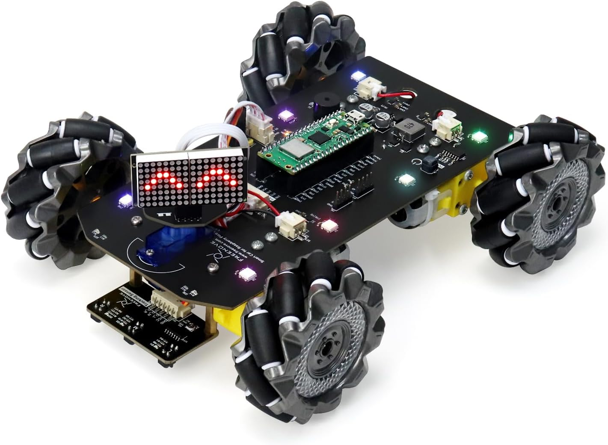
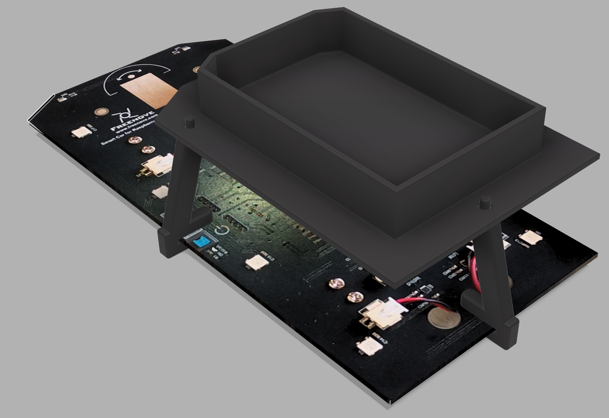
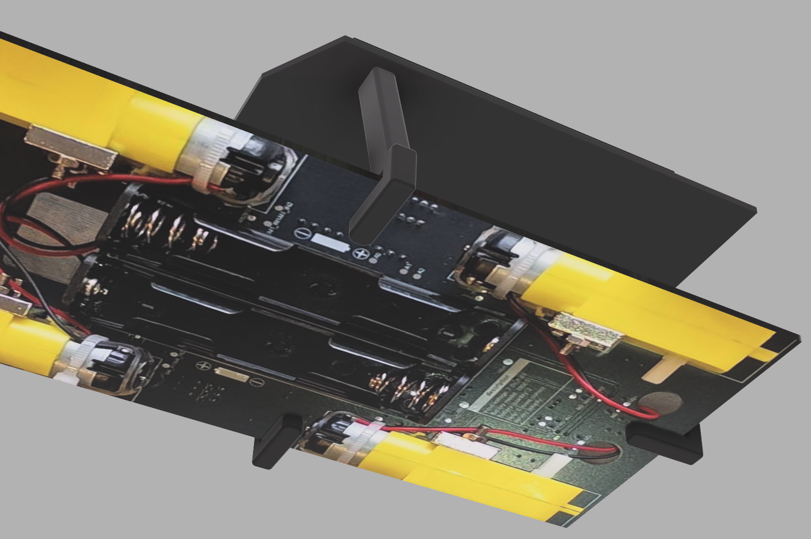

# Roofbox for a remote control car

This is a Freenove Mecanum Wheel Car Kit for Raspberry Pi Pico W:

The 3D model is for a roofbox that fits onto the back of the vehicle and is held in place by friction alone.

